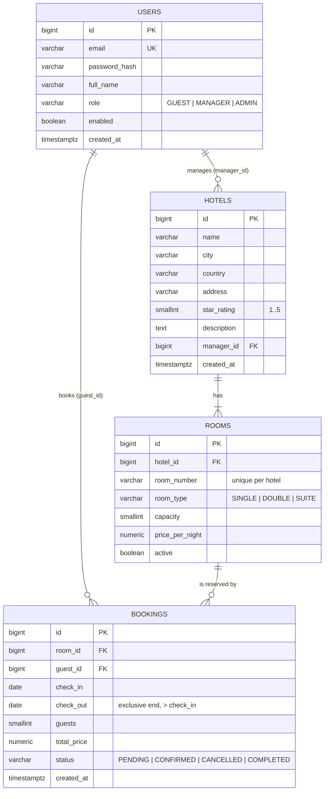
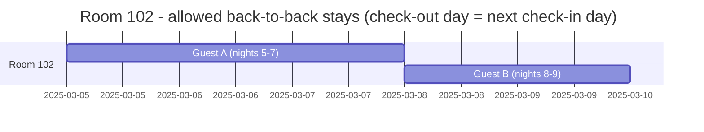
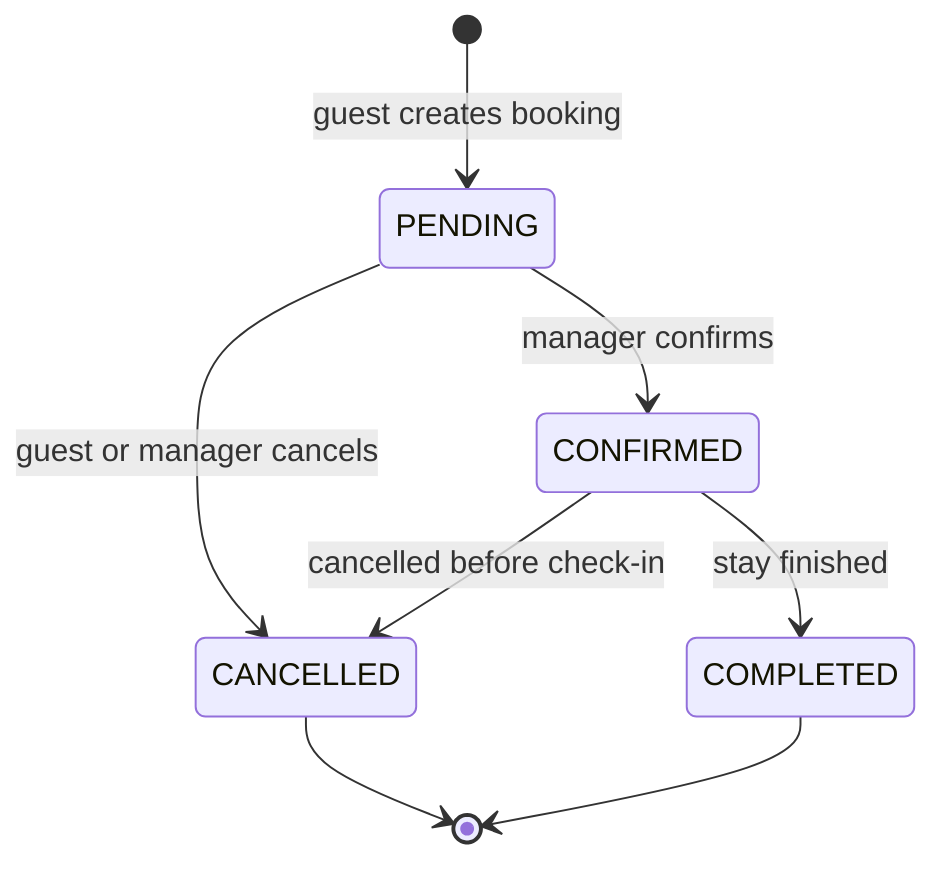

# StayEasy - Data Model

## Entity-relationship diagram



## Roles

| Role | May do |
|------|--------|
| `GUEST` | Register/login, search hotels and rooms, create/cancel **own** bookings, view own bookings |
| `MANAGER` | Everything a guest may + create/update hotels and rooms **they manage**, view bookings of their hotels |
| `ADMIN` | Everything, including managing users and any hotel/booking |

## Availability and the date-overlap rule

Stays are **half-open date ranges** `[check_in, check_out)`: the night of `check_out` is *not* occupied. Two stays of the same room overlap when

```
existing.check_in < requested.check_out  AND  requested.check_in < existing.check_out
```

Only bookings in status `PENDING` or `CONFIRMED` block a room. `CANCELLED` and `COMPLETED` do not.



### Query used by the search endpoint (rooms of a hotel that are free)

```sql
SELECT r.*
FROM rooms r
WHERE r.hotel_id = :hotelId
  AND r.active
  AND r.capacity >= :guests
  AND NOT EXISTS (
      SELECT 1 FROM bookings b
      WHERE b.room_id = r.id
        AND b.status IN ('PENDING', 'CONFIRMED')
        AND b.check_in < :checkOut
        AND :checkIn < b.check_out);
```

### Two layers of protection

1. **Service layer**: check availability and compute `total_price = nights * price_per_night` inside one `@Transactional` method; answer **409 Conflict** when the room is taken.
2. **Database**: the exclusion constraint `excl_no_overlapping_bookings` rejects a conflicting insert even when two requests race. Map the resulting `DataIntegrityViolationException` to the same 409.

## Status life cycle


