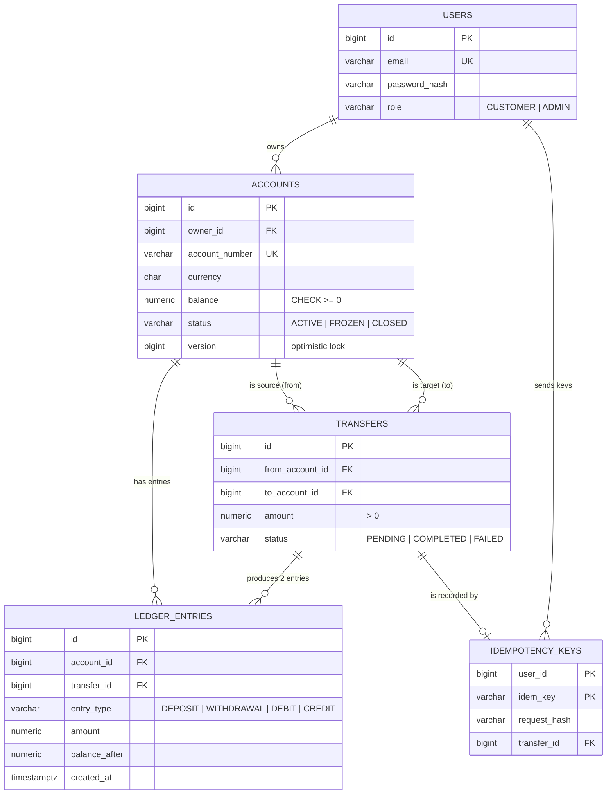
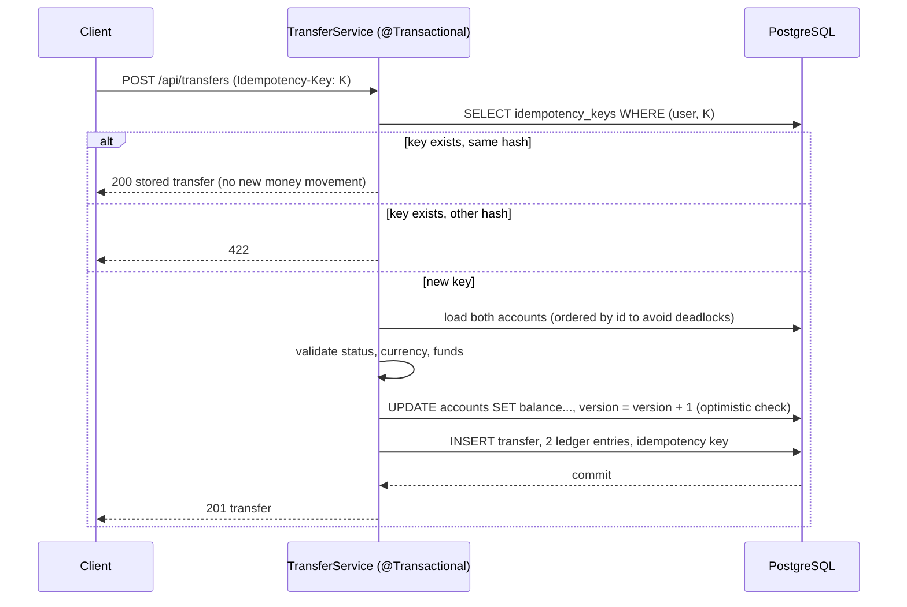

# PayFlow - Data Model

## Core invariants

1. `accounts.balance >= 0` (database CHECK) - no overdrafts.
2. Every balance change writes **exactly one** ledger entry whose `balance_after` equals the new balance.
3. A transfer writes **two** entries (DEBIT on the source, CREDIT on the target) in the **same transaction** as the two balance updates and the transfer row.
4. Ledger entries are append-only: no `UPDATE`/`DELETE` from the application.
5. Same user + same `Idempotency-Key` + same request body => the original result, no second money movement.
6. Same key + **different** body => `422 Unprocessable Entity`.
7. Transfers need `ACTIVE` accounts, equal currencies, `amount > 0` with at most 4 decimals.

## Transfer algorithm (service layer)

### Concurrency strategy

- `@Version` on `Account`: two concurrent transfers from the same account cannot both read the old balance - one fails with `OptimisticLockingFailureException` -> retry (max 3) or answer 409.
- Always touch accounts in **ascending id order** (pessimistic or optimistic) to prevent deadlocks.
- The unique primary key `(user_id, idem_key)` makes duplicate concurrent submissions fail at the database; catch it and return the stored result.

## Monthly statement

`SELECT * FROM fn_monthly_statement(:accountId, :year, :month)` returns the entries of the month with `debit`, `credit` and `running_balance`
(see `database/03_procedures.sql`).
