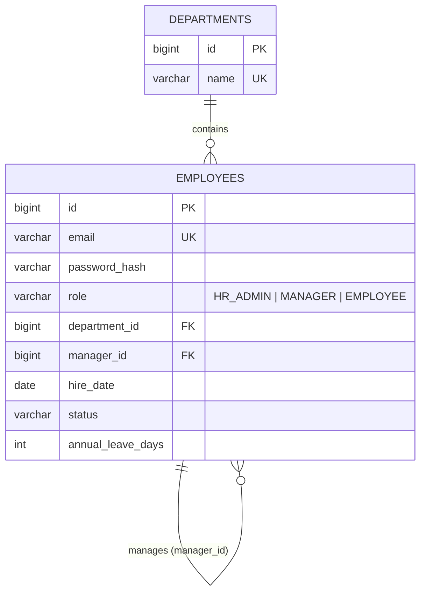
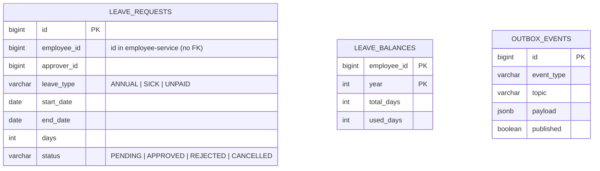
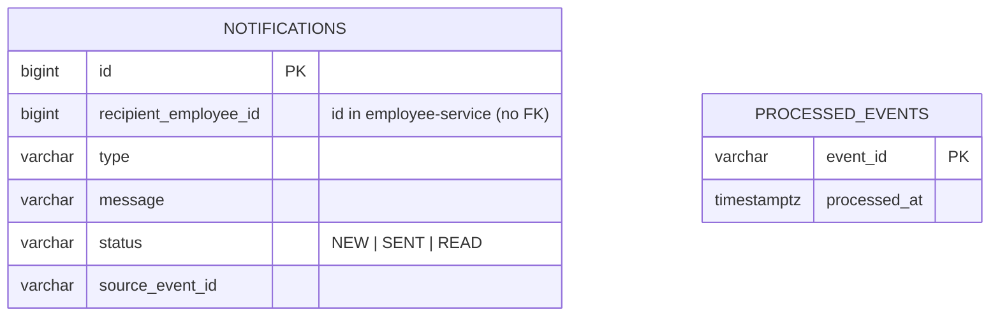

# PeopleHub - Data Model (database per service)

*Database `peoplehub_employee` (employee-service).*

*Database `peoplehub_leave` (leave-service). Approving a request updates `leave_requests`, `leave_balances` and inserts into `outbox_events` in ONE transaction.*

*Database `peoplehub_notification` (notification-service).*

## Why no foreign keys between services?

Each service can be deployed, migrated and scaled independently. Cross-service references are plain ids that you validate via the owning
service's API (`RestClient` + Resilience4j from Day 43) or accept from a trusted token claim. The price is *eventual consistency*:
an employee may be terminated after a leave request was created - handle that with events or compensating actions.
