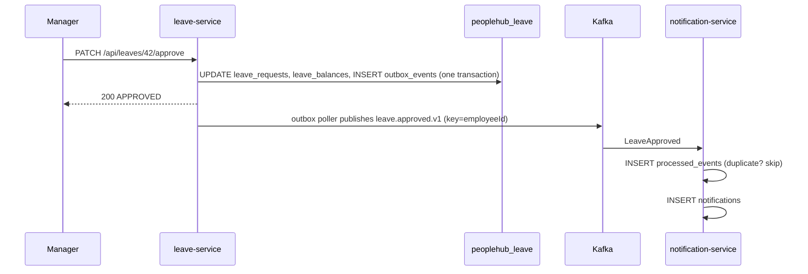

# LeaveApproved event (Kafka)

| | |
|---|---|
| Topic | `leave.approved.v1` (3 partitions locally; DLT: `leave.approved.v1.DLT`) |
| Key | `employeeId` as a string (keeps all events of one employee ordered) |
| Producer | **leave-service** - writes an `outbox_events` row in the same transaction as the approval; a poller publishes it |
| Consumer | **notification-service** - consumer group `notification-service`; creates a notification, idempotent via `processed_events` |
| Delivery | at-least-once; consumers MUST tolerate duplicates |

## Payload (version 1)

```json
{
  "version": 1,
  "eventId": "7d2f6d4c-5c9e-4c53-9a37-6f6a1d1d2b11",
  "leaveRequestId": 42,
  "employeeId": 3,
  "approverId": 2,
  "leaveType": "ANNUAL",
  "startDate": "2025-07-14",
  "endDate": "2025-07-18",
  "days": 5,
  "approvedAt": "2025-07-01T09:30:00Z"
}
```

Rules: add fields only (tolerant reader); bump `version` for breaking changes and publish to a new topic (`leave.approved.v2`)
while v1 consumers migrate; `eventId` is a UUID generated once per approval (reused by outbox retries).

## Flow



## Error handling

- Consumer retries 3 times (`FixedBackOff(1000, 2)`), then the record goes to `leave.approved.v1.DLT`.
- Malformed JSON (poison) must not block the partition: use `ErrorHandlingDeserializer` or parse manually and throw a non-retryable exception.
- Monitor the DLT; replay after fixing the cause.

## Local topic creation (see `setup/KAFKA_SETUP.md`)

```bash
kafka-topics --bootstrap-server localhost:9092 --create --topic leave.approved.v1 --partitions 3 --replication-factor 1
kafka-topics --bootstrap-server localhost:9092 --create --topic leave.approved.v1.DLT --partitions 3 --replication-factor 1
kafka-console-consumer --bootstrap-server localhost:9092 --topic leave.approved.v1 --from-beginning --property print.key=true
```
