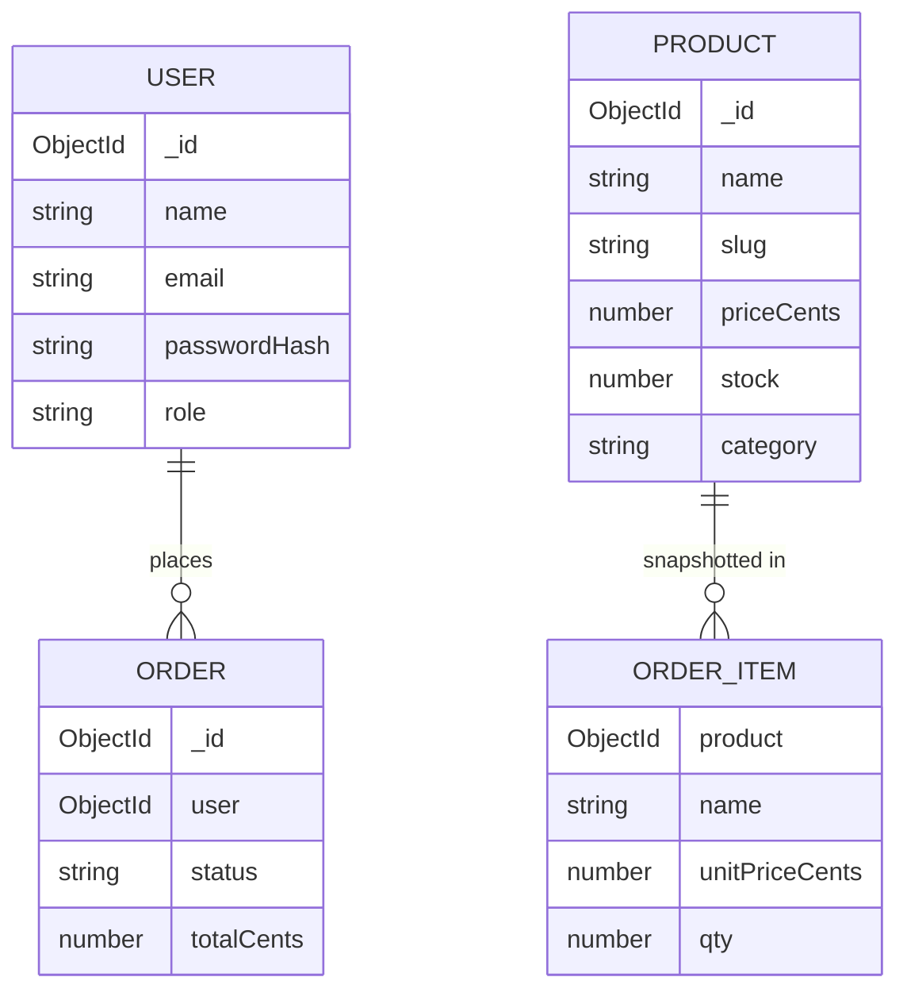

# Data model — E-commerce Store (ShopLite)

This project uses **MongoDB** with **Mongoose**. MongoDB is a document database: there are **no primary keys / foreign keys** like in SQL. Relationships are modeled with:

1. **`_id`** — every document gets an ObjectId automatically (think “primary key”, but generated by MongoDB).
2. **References** — store another document’s `_id` in a field and optionally `populate()` it later (think “foreign key”, but enforced by your application code, not the database engine).
3. **Embedding** — nest related data inside the parent document when it is always read together and does not need its own lifecycle.

## Relationship overview



`ORDER_ITEM` is **embedded** inside `ORDER` (not a separate collection). That is intentional: once an order is placed, prices should not change if the product catalog changes later.

## Decision rule: embed vs reference

| Situation | Choice | Why |
|-----------|--------|-----|
| User ↔ Order | **Reference** `user` ObjectId on Order | Orders are listed per user; users are shared |
| Order ↔ line items | **Embed** `items[]` on Order | Snapshot of purchase; immutable history |
| Product catalog | Own collection | Shared, frequently updated independently |

---

## Collection: `users`

| Field | Type | Rules |
|-------|------|-------|
| `_id` | ObjectId | auto |
| `name` | String | required, trim, min 2 |
| `email` | String | required, unique, lowercase, trim |
| `passwordHash` | String | required (never store plain password) |
| `role` | String | enum: `customer`, `admin`; default `customer` |
| `createdAt` / `updatedAt` | Date | `timestamps: true` |

**Indexes:** unique index on `email`.

**Sample document**

```json
{
  "_id": "665f0c1a2b3c4d5e6f708192",
  "name": "Avery Customer",
  "email": "avery@example.com",
  "passwordHash": "$2a$10$…",
  "role": "customer",
  "createdAt": "2026-10-10T10:00:00.000Z",
  "updatedAt": "2026-10-10T10:00:00.000Z"
}
```

**Mongoose sketch**

```js
const userSchema = new mongoose.Schema(
  {
    name: { type: String, required: true, trim: true, minlength: 2 },
    email: { type: String, required: true, unique: true, lowercase: true, trim: true },
    passwordHash: { type: String, required: true },
    role: { type: String, enum: ['customer', 'admin'], default: 'customer' },
  },
  { timestamps: true },
);
```

---

## Collection: `products`

| Field | Type | Rules |
|-------|------|-------|
| `name` | String | required, trim |
| `slug` | String | required, unique, lowercase |
| `description` | String | required, min 20 chars |
| `priceCents` | Number | required, integer ≥ 0 |
| `stock` | Number | required, integer ≥ 0 |
| `category` | String | required (e.g. `electronics`, `clothing`, `home`) |
| `imageUrl` | String | optional URL or placeholder path |
| `isActive` | Boolean | default `true` |
| timestamps | Date | yes |

**Indexes:** unique `slug`; index on `category`; text index on `name` (optional but recommended for search).

**Sample document**

```json
{
  "_id": "665f0c1a2b3c4d5e6f708193",
  "name": "Wireless Headphones",
  "slug": "wireless-headphones",
  "description": "Comfortable over-ear headphones with 30h battery life.",
  "priceCents": 7900,
  "stock": 25,
  "category": "electronics",
  "imageUrl": "/placeholders/headphones.png",
  "isActive": true
}
```

---

## Collection: `orders`

| Field | Type | Rules |
|-------|------|-------|
| `user` | ObjectId | required, `ref: 'User'` |
| `items` | Array of subdocs | required, min length 1 |
| `items[].product` | ObjectId | `ref: 'Product'` (for traceability) |
| `items[].name` | String | snapshot of name at purchase |
| `items[].unitPriceCents` | Number | snapshot of price |
| `items[].qty` | Number | integer ≥ 1 |
| `status` | String | enum: `pending`, `paid`, `shipped`, `cancelled`; default `pending` |
| `shipping` | Object | `{ fullName, line1, city, postalCode, country }` all required strings |
| `totalCents` | Number | required; must equal sum of `unitPriceCents * qty` |
| timestamps | Date | yes |

**Indexes:** `{ user: 1, createdAt: -1 }`; `{ status: 1 }`.

**Sample document**

```json
{
  "_id": "665f0c1a2b3c4d5e6f708194",
  "user": "665f0c1a2b3c4d5e6f708192",
  "items": [
    {
      "product": "665f0c1a2b3c4d5e6f708193",
      "name": "Wireless Headphones",
      "unitPriceCents": 7900,
      "qty": 1
    }
  ],
  "status": "paid",
  "shipping": {
    "fullName": "Avery Customer",
    "line1": "12 Market Street",
    "city": "Austin",
    "postalCode": "78701",
    "country": "US"
  },
  "totalCents": 7900
}
```

### Stock updates (application-level integrity)

When an order is placed:

1. For each item, decrement `product.stock` by `qty` **only if** `stock >= qty` (use a conditional update).
2. If any item fails, abort the order (return **400** / **409**) — do not leave partial stock changes.
3. Prefer a MongoDB session/transaction if your Atlas tier supports it; if not, document a careful sequential update + compensating logic.

---

## What is NOT stored in MongoDB

- **Cart contents** for guests/customers live in the **frontend Redux store** (persisted to `localStorage`). Persist carts to MongoDB only as a stretch goal.
- **JWT secrets** live in `.env`, never in the database.

## Common queries (examples)

```js
// Catalog page
Product.find({ isActive: true, category })
  .sort(sortSpec)
  .skip((page - 1) * limit)
  .limit(limit);

// Order history for logged-in user
Order.find({ user: req.user.id }).sort({ createdAt: -1 }).populate('user', 'name email');

// Admin: update status
Order.findByIdAndUpdate(id, { status: 'shipped' }, { new: true, runValidators: true });
```
