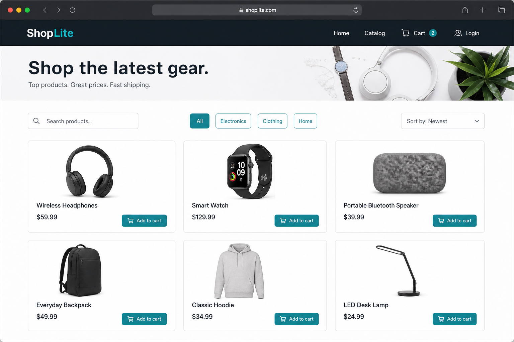
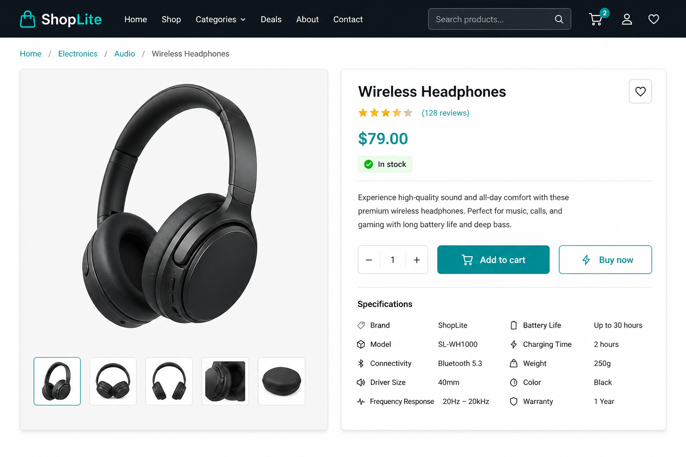
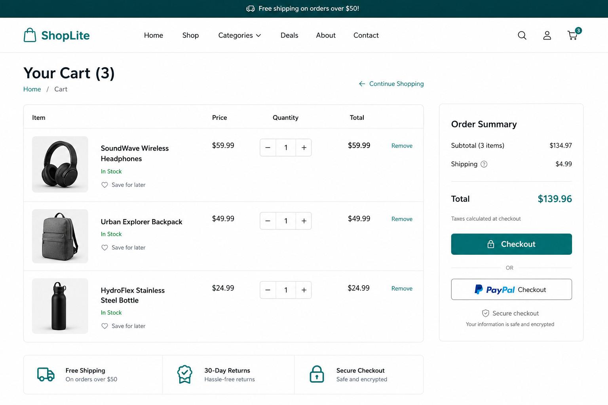
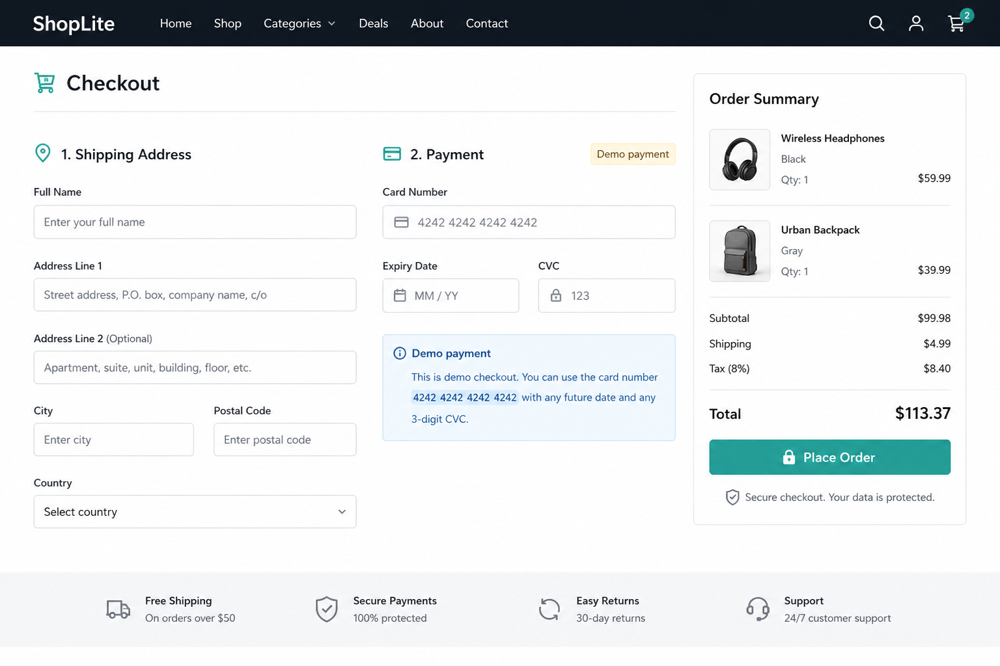
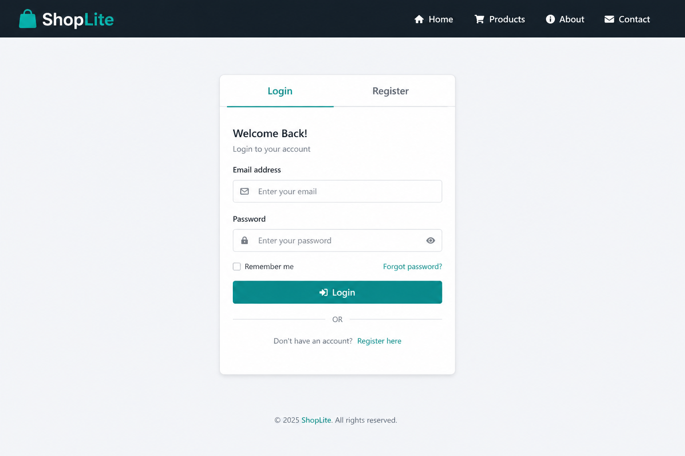
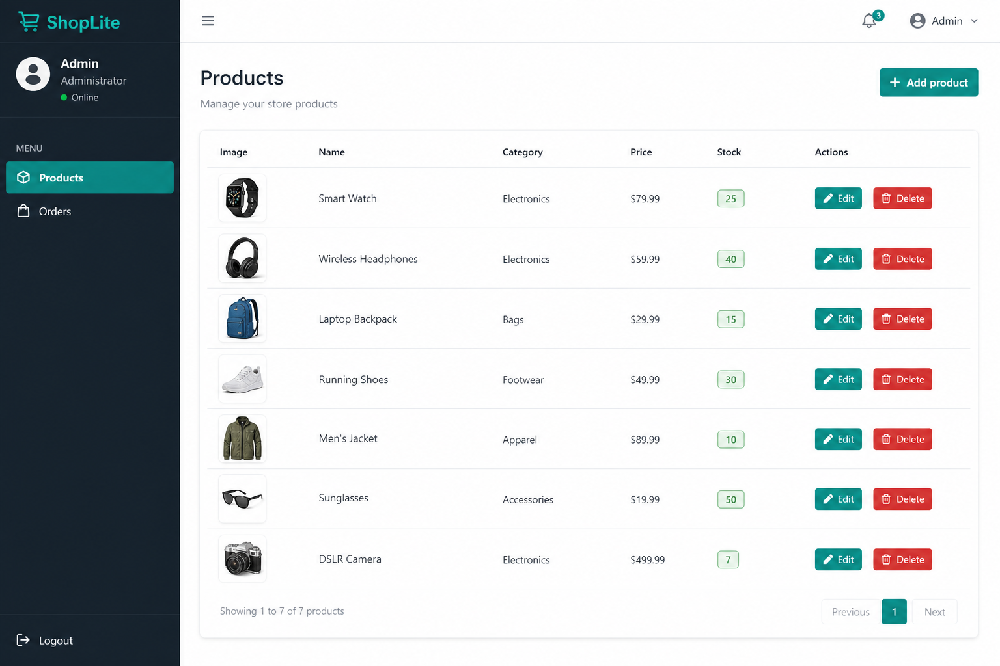

# Project instructions — E-commerce Store (ShopLite)

This is a **major full-stack assignment**. The boilerplate already runs (React + Express + sample `/api/welcome` integration). Your job is to turn it into a portfolio-ready mini shop with auth, catalog, cart (Redux), checkout, orders, and an admin area.

Also read:

- [README.md](./README.md) — setup, `MONGO_URI`, run commands
- [DATA_MODEL.md](./DATA_MODEL.md) — MongoDB collections
- [GRADING_CRITERIA.md](./GRADING_CRITERIA.md) — scoring /100
- Mockups in [docs/mockups/](./docs/mockups/)

---

## 1. Learning goals (mapped to the course)

| Area | Course days (approx.) | You will practice |
|------|------------------------|-------------------|
| HTML/CSS/Bootstrap layout | 01–16 | Responsive shop UI |
| React components, props, state, effects | 34–37 | Pages, forms, lists |
| Keys, composition | 36–38 | Product grids, cart lines |
| Redux Toolkit + thunks | 39–40 | auth, cart, products, orders |
| Node ESM, Express routes, middleware | 41–42 | REST API |
| JWT auth + roles | 43 | customer vs admin |
| Mongoose models + CRUD | 44–45 | products, orders, users |

After this project you should be comfortable joining a real team codebase that uses React + Node + MongoDB.

---

## 2. Product overview

**ShopLite** is a small online store.

### Roles

| Role | Can do |
|------|--------|
| Guest | Browse catalog + product detail; see login/register |
| `customer` | Everything guest can + manage cart, checkout, view own orders |
| `admin` | Everything customer can + create/edit/deactivate products, update order status, view all orders |

### Non-goals (do not build unless stretch)

- Real payment gateway (Stripe etc.) — use a **mock payment** checkbox/form
- Email notifications
- Multi-currency
- Inventory warehouses / shipping carriers

---

## 3. Tech stack (required)

**Frontend**

- React 18 + Vite
- React Router v6
- Bootstrap 5 (plain CSS classes) + per-component `.css` files
- Redux Toolkit + React-Redux
- `fetch` via `src/api/client.js` (extend it; attach JWT)

**Backend**

- Node 18+ ES modules
- Express, Mongoose 8, dotenv, cors, morgan
- bcryptjs + jsonwebtoken
- Vitest + Supertest (setup provided; write more tests optional)

**Database**

- MongoDB Atlas — put URI in `backend/.env` as `MONGO_URI` (see README)

---

## 4. Mockups (UI target)

Build pages that clearly match these layouts (pixel-perfect is not required; structure and hierarchy are).

### 4.1 Catalog home



Must include: navbar, search, category filters, sort, product card grid (image, name, price, add-to-cart).

### 4.2 Product detail



Must include: image, title, price, stock indicator, quantity, add-to-cart, description.

### 4.3 Cart



Must include: line items with qty controls, remove, order summary, checkout CTA. Empty cart state required.

### 4.4 Checkout



Must include: shipping form, mock payment fields, order summary, place order.

### 4.5 Login / Register



Must include: login + register forms (tabs or separate routes).

### 4.6 Admin products



Must include: products table, add/edit actions, stock, only visible to `admin`.

---

## 5. Frontend architecture

### 5.1 Routes (minimum)

| Path | Access | Page |
|------|--------|------|
| `/` | public | Marketing/home (boilerplate welcome can stay or become shop landing) |
| `/catalog` | public | Product list |
| `/products/:slug` | public | Product detail |
| `/cart` | public (checkout requires auth) | Cart |
| `/checkout` | `customer` or `admin` | Checkout |
| `/orders` | authenticated | Current user orders |
| `/login`, `/register` | guest | Auth |
| `/admin/products` | `admin` | Product CRUD |
| `/admin/orders` | `admin` | All orders + status updates |
| `*` | public | NotFound (provided) |

Use a `ProtectedRoute` component that checks Redux auth state + optional `roles={['admin']}`.

### 5.2 Redux slices (required)

| Slice | Responsibilities |
|-------|------------------|
| `auth` | user, token, login/register/logout thunks; hydrate from `localStorage` |
| `cart` | items `{ productId, name, unitPriceCents, qty, imageUrl? }`; add/update/remove/clear; **persist to localStorage** |
| `products` | list + detail fetch; admin create/update |
| `orders` | create order thunk; list mine; admin list/update status |
| `welcome` | already provided — keep as reference |

### 5.3 Component / CSS convention

```
src/pages/Catalog/Catalog.jsx
src/pages/Catalog/Catalog.css
src/components/ProductCard/ProductCard.jsx
src/components/ProductCard/ProductCard.css
```

- Bootstrap for grid/nav/forms/buttons
- Component CSS only for custom look (prefix classes)

---

## 6. Backend API contract

Base URL: `http://localhost:5001` (or `PORT` in `.env`).  
Frontend uses Vite proxy: browser calls `/api/...`.

### 6.1 Common error shape

```json
{
  "error": "validation_error",
  "message": "Human readable explanation"
}
```

Use appropriate status codes: **400** validation, **401** unauthenticated, **403** forbidden, **404** missing, **409** conflict (email taken / insufficient stock), **500** unexpected.

### 6.2 Auth

#### `POST /api/auth/register`

Body:

```json
{ "name": "Avery", "email": "avery@example.com", "password": "secret123" }
```

Rules:

- Password min length 8
- Role always `customer` for public register (do **not** allow clients to self-assign `admin`)
- Hash password with bcrypt
- **201** `{ user: { id, name, email, role }, token }`
- **409** if email exists

#### `POST /api/auth/login`

Body: `{ "email", "password" }`  
**200** `{ user, token }` or **401** invalid credentials.

#### `GET /api/auth/me`

Header: `Authorization: Bearer <token>`  
**200** current user (no passwordHash) or **401**.

Provide middleware: `requireAuth`, `requireRole('admin')`.

### 6.3 Products

| Method | Path | Auth | Behavior |
|--------|------|------|----------|
| GET | `/api/products` | public | Query: `q`, `category`, `sort` (`price_asc`/`price_desc`/`newest`), `page`, `limit`. Return `{ items, page, total, pages }` of **active** products |
| GET | `/api/products/:slug` | public | Single active product or 404 |
| POST | `/api/products` | admin | Create product |
| PATCH | `/api/products/:id` | admin | Update fields including `stock`, `isActive` |
| DELETE | `/api/products/:id` | admin | Soft-delete preferred (`isActive: false`) or hard delete — document your choice |

**POST body example**

```json
{
  "name": "Wireless Headphones",
  "slug": "wireless-headphones",
  "description": "Comfortable over-ear headphones with 30h battery life.",
  "priceCents": 7900,
  "stock": 25,
  "category": "electronics",
  "imageUrl": ""
}
```

### 6.4 Orders

| Method | Path | Auth | Behavior |
|--------|------|------|----------|
| POST | `/api/orders` | customer/admin | Create order from body items + shipping; validate stock; decrement stock; compute `totalCents` server-side (do not trust client total) |
| GET | `/api/orders/mine` | auth | Current user's orders newest first |
| GET | `/api/orders` | admin | All orders (optional filters by status) |
| PATCH | `/api/orders/:id/status` | admin | Body `{ "status": "shipped" }` |

**POST /api/orders body**

```json
{
  "items": [{ "productId": "…", "qty": 2 }],
  "shipping": {
    "fullName": "Avery Customer",
    "line1": "12 Market Street",
    "city": "Austin",
    "postalCode": "78701",
    "country": "US"
  },
  "payment": { "method": "mock_card", "ok": true }
}
```

If `payment.ok` is not true → **400**.  
If stock insufficient → **409** `{ error: "insufficient_stock", message: "…" }`.

---

## 7. User stories & acceptance criteria

### US-01 Browse catalog

**As a** guest, **I want** to search and filter products **so that** I can find items.

Acceptance:

- [ ] Catalog page loads products from API
- [ ] Search by name works
- [ ] Category filter works
- [ ] Sort by price works
- [ ] Pagination or “load more” works if > page size

### US-02 View product + add to cart

Acceptance:

- [ ] Detail page by slug
- [ ] Shows out-of-stock clearly when `stock === 0`
- [ ] Add to cart updates Redux cart and persists after refresh

### US-03 Checkout

Acceptance:

- [ ] Checkout blocked when not logged in (redirect to login with return URL)
- [ ] Shipping validation required
- [ ] Successful order clears cart and shows confirmation / redirects to `/orders`
- [ ] Stock decreases in DB

### US-04 Order history

Acceptance:

- [ ] Customer sees only their orders
- [ ] Admin can see all orders and change status

### US-05 Admin product management

Acceptance:

- [ ] Non-admin receives **403** on admin APIs and cannot open admin UI
- [ ] Admin can create and edit products
- [ ] Inactive products disappear from public catalog

---

## 8. Security checklist

- [ ] `JWT_SECRET` from env; tokens expire (e.g. `7d` or `1d`)
- [ ] Passwords hashed (bcrypt cost factor ≥ 10)
- [ ] Never return `passwordHash` in JSON
- [ ] Validate all bodies (type checks / simple schema validation)
- [ ] CORS limited to `CLIENT_ORIGIN`
- [ ] Rate limiting optional stretch
- [ ] No secrets in git

---

## 9. Ordered milestones

### Milestone A — Foundations

1. Set `MONGO_URI` and confirm Home shows welcome message
2. Create `User`, `Product`, `Order` models per `DATA_MODEL.md`
3. Seed at least 8 products + 1 admin user (script or manual) — document how in README

### Milestone B — Auth

4. Register/login/me routes + middleware
5. Redux `auth` slice + login/register pages
6. Persist token; attach Authorization header in `api/client.js`

### Milestone C — Catalog + cart

7. Products list/detail APIs + Catalog/Detail pages
8. Redux cart with localStorage persistence
9. Cart page matching mockup

### Milestone D — Checkout + orders

10. Create order API with stock checks
11. Checkout page + orders page
12. Admin order status UI

### Milestone E — Admin products + polish

13. Admin product CRUD UI
14. Loading/empty/error states everywhere
15. Self-grade with `GRADING_CRITERIA.md`

---

## 10. Stretch goals (optional)

- Product image upload (or URL validation)
- Coupon codes
- Order invoice PDF
- Wishlist
- Backend cart persistence
- Deploy frontend (Netlify/Vercel) + backend (Render/Railway) with Atlas

---

## 11. Submission checklist

- [ ] `backend/.env` not committed; `.env.example` updated if you added vars
- [ ] `npm test` still passes for welcome (and any tests you add)
- [ ] `npm run build` succeeds in frontend
- [ ] README lists seed credentials for the demo admin (not a production password)
- [ ] Short “How to demo” section: register → browse → buy → admin ship

---

## 12. Definition of done

A reviewer with only this repo + a MongoDB URI can:

1. Start backend and frontend
2. Register a customer, browse, checkout a product
3. Log in as admin, edit a product, mark an order shipped
4. Confirm data in MongoDB matches `DATA_MODEL.md`
