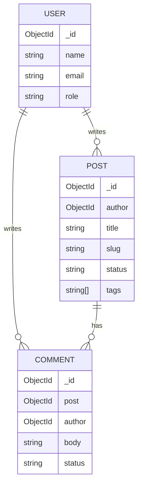

# Data model — Blog CMS (InkBoard)

MongoDB has **no SQL primary/foreign keys**. Use `_id` ObjectIds, **references** (`ref` + `populate`), or **embedding** when data is owned and always loaded with the parent.

## Relationship overview



## Embed vs reference

| Data | Choice | Why |
|------|--------|-----|
| Post author | **Reference** User | Users are shared; need populate for byline |
| Tags on post | **Embed** `string[]` | Small, queried with the post, no separate lifecycle |
| Comments | **Separate collection** referencing Post + User | Can grow large; moderation workflows |

---

## Collection: `users`

| Field | Type | Rules |
|-------|------|-------|
| `name` | String | required, trim, min 2 |
| `email` | String | required, unique, lowercase |
| `passwordHash` | String | required |
| `role` | String | enum `reader`, `author`, `admin`; default `reader` |
| `bio` | String | optional, max 280 |
| timestamps | yes | |

Public register may create `reader` or `author` only (never `admin` from the client). Seed an admin separately.

**Sample**

```json
{
  "_id": "665f10000000000000000001",
  "name": "Jordan Author",
  "email": "jordan@example.com",
  "passwordHash": "$2a$10$…",
  "role": "author",
  "bio": "Writes about web foundations."
}
```

---

## Collection: `posts`

| Field | Type | Rules |
|-------|------|-------|
| `title` | String | required, trim, min 3 |
| `slug` | String | required, unique, lowercase |
| `body` | String | required, min 50 chars (markdown or plain text) |
| `excerpt` | String | optional; if missing, derive first ~160 chars of body |
| `tags` | [String] | default `[]`; lowercase, trim |
| `status` | String | enum `draft`, `published`; default `draft` |
| `author` | ObjectId | required, `ref: 'User'` |
| `publishedAt` | Date | set when first published |
| timestamps | yes | |

**Indexes:** unique `slug`; `{ status: 1, publishedAt: -1 }`; `{ author: 1, updatedAt: -1 }`; `{ tags: 1 }`.

**Sample**

```json
{
  "_id": "665f10000000000000000002",
  "title": "Why semantic HTML still matters",
  "slug": "why-semantic-html-still-matters",
  "body": "Long form content…",
  "excerpt": "Landmarks and headings are not optional polish…",
  "tags": ["html", "a11y"],
  "status": "published",
  "author": "665f10000000000000000001",
  "publishedAt": "2026-10-01T12:00:00.000Z"
}
```

### Access rules (application layer)

- Public feed: only `status: "published"`
- Author can CRUD **own** drafts/published posts
- Admin can moderate any post (unpublish) as stretch; minimum admin scope is comments/users

---

## Collection: `comments`

| Field | Type | Rules |
|-------|------|-------|
| `post` | ObjectId | required, `ref: 'Post'` |
| `author` | ObjectId | required, `ref: 'User'` |
| `body` | String | required, trim, min 1, max 2000 |
| `status` | String | enum `visible`, `hidden`, `pending`; default `visible` (or `pending` if you want moderation-first) |
| timestamps | yes | |

**Indexes:** `{ post: 1, createdAt: 1 }`; `{ status: 1 }`.

**Sample**

```json
{
  "_id": "665f10000000000000000003",
  "post": "665f10000000000000000002",
  "author": "665f10000000000000000004",
  "body": "Great checklist for landmarks!",
  "status": "visible"
}
```

## Common queries

```js
// Public feed
Post.find({ status: 'published', ...(tag && { tags: tag }) })
  .sort({ publishedAt: -1 })
  .skip((page - 1) * limit)
  .limit(limit)
  .populate('author', 'name');

// Author dashboard
Post.find({ author: req.user.id }).sort({ updatedAt: -1 });

// Comments for a post
Comment.find({ post: postId, status: 'visible' })
  .sort({ createdAt: 1 })
  .populate('author', 'name');
```
