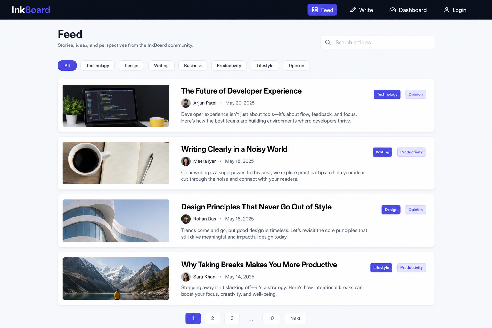
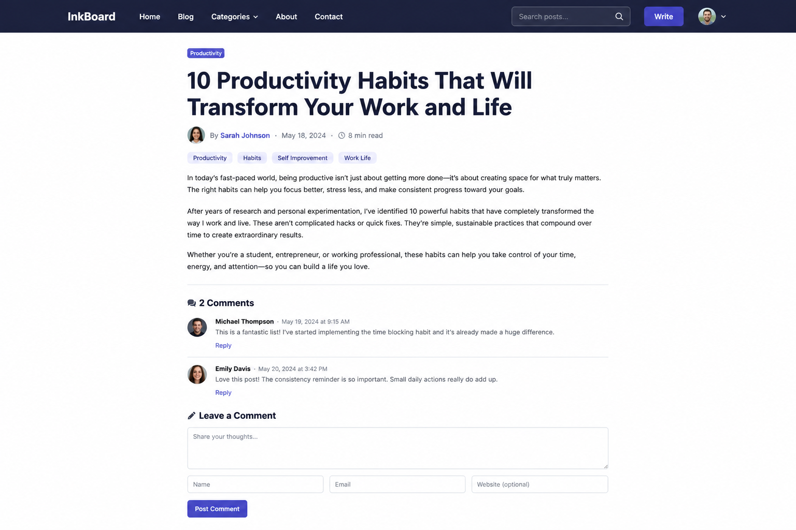
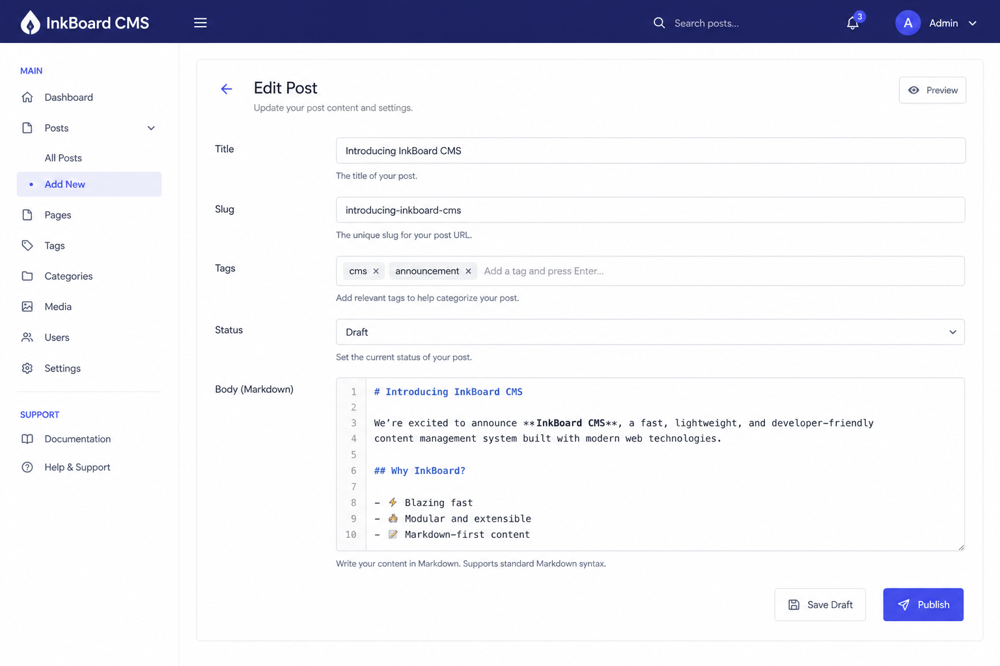
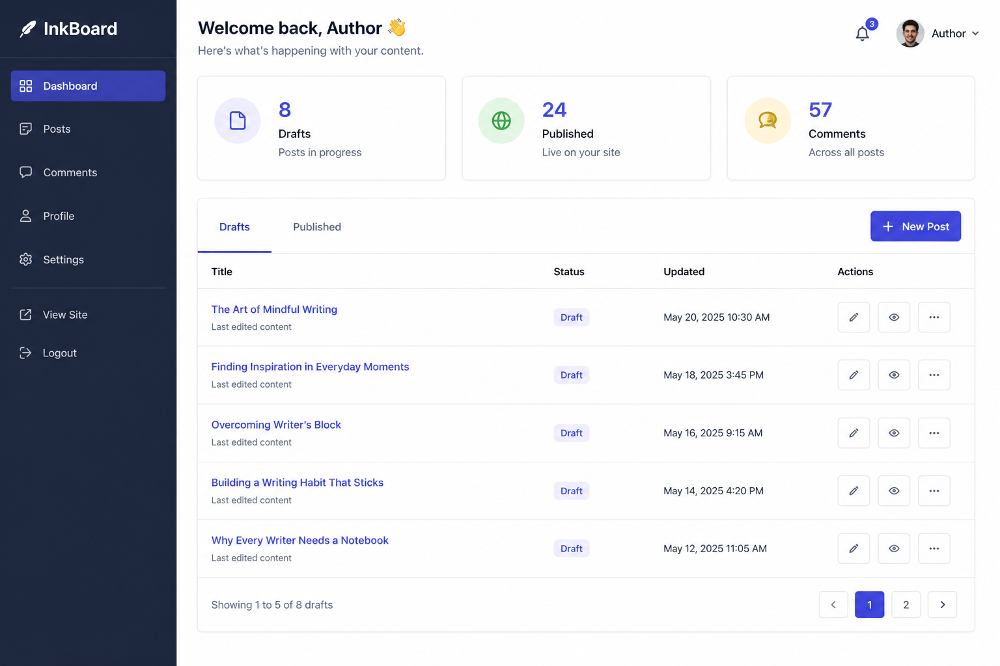
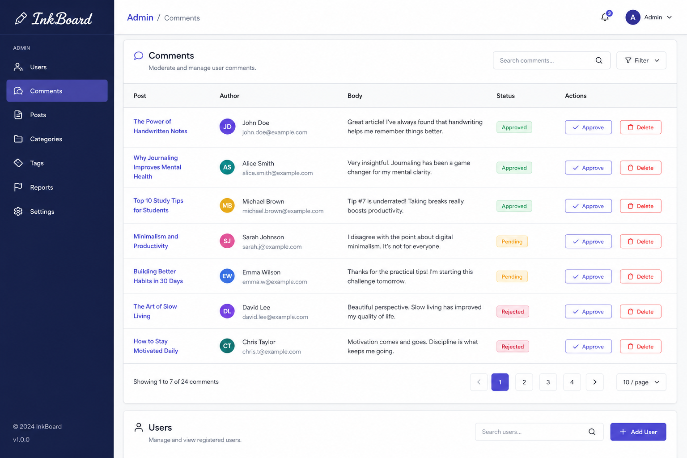

# Project instructions — Blog CMS (InkBoard)

Build a production-style blogging platform with roles, publishing workflow, comments, and moderation. The boilerplate already wires React Router, Bootstrap, AuthContext, Express, and a sample `/api/welcome` call.

Also read [README.md](./README.md), [DATA_MODEL.md](./DATA_MODEL.md), [GRADING_CRITERIA.md](./GRADING_CRITERIA.md), and mockups under [docs/mockups/](./docs/mockups/).

---

## 1. Learning goals

| Area | Practice |
|------|----------|
| React Router + layouts | Multi-page CMS shell |
| Context API for auth | Contrast with Redux projects (P01/P03) |
| Controlled forms | Editor, comments, login |
| Express + JWT roles | `reader` / `author` / `admin` |
| Mongoose refs + indexes | Posts, comments, slug uniqueness |

---

## 2. Product overview

**InkBoard** lets readers browse published posts, authors manage drafts, and admins moderate comments (and optionally users).

| Role | Capabilities |
|------|----------------|
| Guest | Read published feed + post detail |
| `reader` | Guest + comment on published posts |
| `author` | Reader + create/edit own posts, publish/unpublish own posts |
| `admin` | Author powers + hide comments, list users, promote/demote roles (at least hide comments required) |

Non-goals unless stretch: rich WYSIWYG, image CDN, email digests, full-text search engine.

---

## 3. Tech stack

- Frontend: React 18, Vite, React Router, Bootstrap, **Context API (no Redux required)**
- Backend: Express ESM, Mongoose 8, bcryptjs, jsonwebtoken
- DB: MongoDB Atlas via `MONGO_URI` in `backend/.env` (port **5002**)

---

## 4. Mockups

### Feed

Tag filters, search, article cards (title, author, date, tags, excerpt).

### Post detail

Article body + comments list + comment form (auth required to post).

### Post editor

Title, slug, tags, status, body, save draft / publish.

### Author dashboard

Drafts/published tabs, stats, new post CTA, edit actions.

### Login / Register

### Admin moderation

Comments table with approve/hide/delete; users list optional but recommended.

---

## 5. Frontend architecture

### Routes

| Path | Access | Page |
|------|--------|------|
| `/` | public | Home (welcome) or redirect to `/feed` |
| `/feed` | public | Published posts |
| `/posts/:slug` | public | Post detail + comments |
| `/login`, `/register` | guest | Auth |
| `/dashboard` | author/admin | Author dashboard |
| `/editor`, `/editor/:id` | author/admin | Create/edit post |
| `/admin/comments` | admin | Moderation |
| `/admin/users` | admin | Users list (recommended) |
| `*` | public | NotFound |

Expand `AuthContext` with `login`, `register`, `logout`, and `user.role`. Provide `<ProtectedRoute roles={[…]} />`.

### Styling

Same Bootstrap + per-component CSS folder pattern as the boilerplate.

---

## 6. Backend API contract

Error shape: `{ "error": "code", "message": "…" }`.

### Auth

- `POST /api/auth/register` — body `{ name, email, password, role? }` where `role` may be `reader`|`author` only → **201** `{ user, token }`
- `POST /api/auth/login` → **200** `{ user, token }`
- `GET /api/auth/me` → **200** user

Middleware: `requireAuth`, `requireRole(...roles)`.

### Posts

| Method | Path | Auth | Notes |
|--------|------|------|-------|
| GET | `/api/posts` | public | Only `published`. Query: `tag`, `q`, `page`, `limit` |
| GET | `/api/posts/:slug` | public | Published only (authors may fetch own draft via separate route) |
| GET | `/api/posts/mine` | author/admin | All statuses for current author |
| POST | `/api/posts` | author/admin | Create draft/published |
| PATCH | `/api/posts/:id` | author/admin | Owner or admin; validate slug uniqueness |
| DELETE | `/api/posts/:id` | author/admin | Owner or admin |

When status becomes `published` first time, set `publishedAt`.

### Comments

| Method | Path | Auth | Notes |
|--------|------|------|-------|
| GET | `/api/posts/:postId/comments` | public | `visible` only (admin can request all via query `?all=1`) |
| POST | `/api/posts/:postId/comments` | reader+ | Body `{ body }` |
| PATCH | `/api/comments/:id` | admin | `{ status: 'hidden' \| 'visible' }` |
| DELETE | `/api/comments/:id` | admin or comment author | Document your rule |

### Admin users (recommended)

- `GET /api/admin/users` — admin
- `PATCH /api/admin/users/:id/role` — admin; cannot remove the last admin

---

## 7. User stories

### US-01 Public reading

- [ ] Feed shows only published posts
- [ ] Tag filter works
- [ ] Post detail resolves by slug

### US-02 Authoring

- [ ] Author creates draft, sees it in dashboard, not in public feed
- [ ] Publishing makes it appear on `/feed`
- [ ] Author cannot edit another author’s post (**403**)

### US-03 Comments

- [ ] Logged-in reader can comment
- [ ] Guest sees comments but is prompted to login to write
- [ ] Admin can hide a comment; it disappears for public

### US-04 Admin

- [ ] Non-admin cannot open `/admin/*` or call admin APIs

---

## 8. Security checklist

- bcrypt passwords; JWT from env with expiry
- Never trust client `author` field — set from `req.user.id`
- Validate slug format (`^[a-z0-9]+(?:-[a-z0-9]+)*$`)
- CORS via `CLIENT_ORIGIN`
- No secrets in git

---

## 9. Ordered milestones

1. MongoURI + welcome message works  
2. User/Post/Comment models  
3. Auth routes + AuthContext login/register  
4. Public feed + detail  
5. Author dashboard + editor  
6. Comments  
7. Admin moderation  
8. Polish + self-grade  

---

## 10. Stretch

- Markdown preview, cover images, RSS, full-text search, soft-delete posts, audit log

## 11. Submission checklist

- [ ] Seed script or documented admin credentials  
- [ ] Frontend build succeeds  
- [ ] Demo script: register author → publish → comment as reader → hide as admin  

## 12. Definition of done

Reviewer can run the app with Atlas URI and complete the full publish + comment + moderate loop without code changes beyond `.env`.
