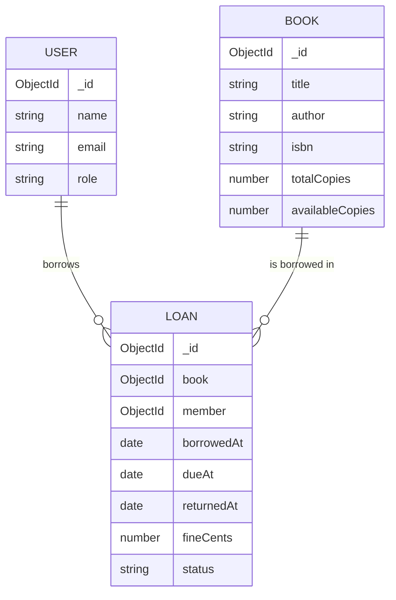

# Data model — Library Management (ShelfKeep)

MongoDB does **not** enforce primary/foreign keys. You model relationships with `_id` ObjectIds and either **references** or **embedding**. For a library, loans need their own lifecycle, so they are a separate collection with references to books and members.

## Relationship overview



## Embed vs reference

| Data | Choice | Why |
|------|--------|-----|
| Loan → Book | **Reference** | Book catalog is shared; availability changes over time |
| Loan → Member (User) | **Reference** | Members have many loans over time |
| Copies count | Fields on Book | Avoid a separate Copy collection for this assignment (stretch: per-copy barcodes) |

---

## Collection: `users`

| Field | Type | Rules |
|-------|------|-------|
| `name` | String | required |
| `email` | String | required, unique, lowercase |
| `passwordHash` | String | required |
| `role` | String | enum `member`, `librarian`; default `member` |
| timestamps | yes | |

Public register creates `member` only. Seed at least one `librarian`.

---

## Collection: `books`

| Field | Type | Rules |
|-------|------|-------|
| `title` | String | required, trim |
| `author` | String | required, trim |
| `genre` | String | required |
| `isbn` | String | required, unique, trim |
| `description` | String | optional |
| `totalCopies` | Number | required, integer ≥ 1 |
| `availableCopies` | Number | required, integer ≥ 0; must be ≤ `totalCopies` |
| `coverUrl` | String | optional |
| timestamps | yes | |

**Indexes:** unique `isbn`; text or regex search on `title`/`author`; `{ genre: 1 }`.

**Invariant:** `0 <= availableCopies <= totalCopies`. Enforce in application code on issue/return.

**Sample**

```json
{
  "_id": "665f20000000000000000001",
  "title": "Eloquent JavaScript",
  "author": "Marijn Haverbeke",
  "genre": "Programming",
  "isbn": "9781593279509",
  "totalCopies": 5,
  "availableCopies": 3,
  "description": "A modern introduction to programming."
}
```

---

## Collection: `loans`

| Field | Type | Rules |
|-------|------|-------|
| `book` | ObjectId | required, `ref: 'Book'` |
| `member` | ObjectId | required, `ref: 'User'` |
| `borrowedAt` | Date | required, default now |
| `dueAt` | Date | required (e.g. borrowedAt + 14 days) |
| `returnedAt` | Date | null until returned |
| `status` | String | enum `active`, `returned`, `overdue`; default `active` |
| `fineCents` | Number | default 0; integer ≥ 0 |
| timestamps | yes | |

**Indexes:** `{ member: 1, status: 1 }`; `{ book: 1, status: 1 }`; `{ dueAt: 1, status: 1 }`.

**Sample**

```json
{
  "_id": "665f20000000000000000002",
  "book": "665f20000000000000000001",
  "member": "665f20000000000000000003",
  "borrowedAt": "2026-10-01T10:00:00.000Z",
  "dueAt": "2026-10-15T10:00:00.000Z",
  "returnedAt": null,
  "status": "active",
  "fineCents": 0
}
```

## Borrow / return algorithm (required)

### Issue (borrow)

1. Load book; if `availableCopies < 1` → **409** `not_available`
2. Optionally limit active loans per member (e.g. max 5) → **409**
3. Atomically decrement availability, e.g.:

```js
const book = await Book.findOneAndUpdate(
  { _id: bookId, availableCopies: { $gte: 1 } },
  { $inc: { availableCopies: -1 } },
  { new: true },
);
if (!book) throw conflict('not_available');
```

4. Create loan with `dueAt = now + LOAN_DAYS` (use env `LOAN_DAYS=14`)

### Return

1. Load active loan; if missing → **404**
2. Compute fine: e.g. `FINE_PER_DAY_CENTS=50` × full days late after `dueAt` (0 if on time)
3. Set `returnedAt`, `status: 'returned'`, `fineCents`
4. `$inc: { availableCopies: 1 }` but do not exceed `totalCopies`

### Overdue report

Either:

- Periodically / on read: if `status === 'active' && dueAt < now`, treat as overdue (virtual or update status), **or**
- Query `status: 'active', dueAt: { $lt: new Date() }` for librarian dashboard

Document which approach you chose in README.

## Common queries

```js
// Catalog search
Book.find({
  $or: [
    { title: new RegExp(q, 'i') },
    { author: new RegExp(q, 'i') },
  ],
  ...(genre && { genre }),
});

// Member dashboard
Loan.find({ member: req.user.id })
  .sort({ borrowedAt: -1 })
  .populate('book', 'title author isbn');

// Librarian overdue
Loan.find({ status: 'active', dueAt: { $lt: new Date() } })
  .populate('book', 'title')
  .populate('member', 'name email');
```
