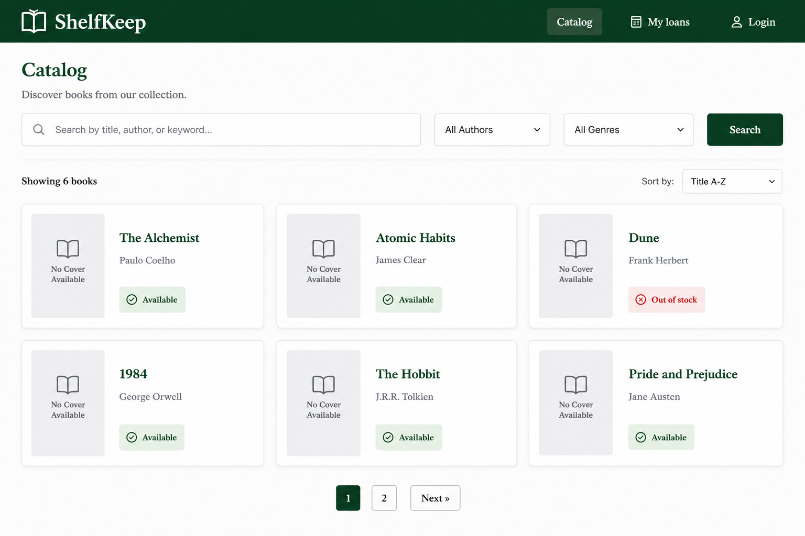
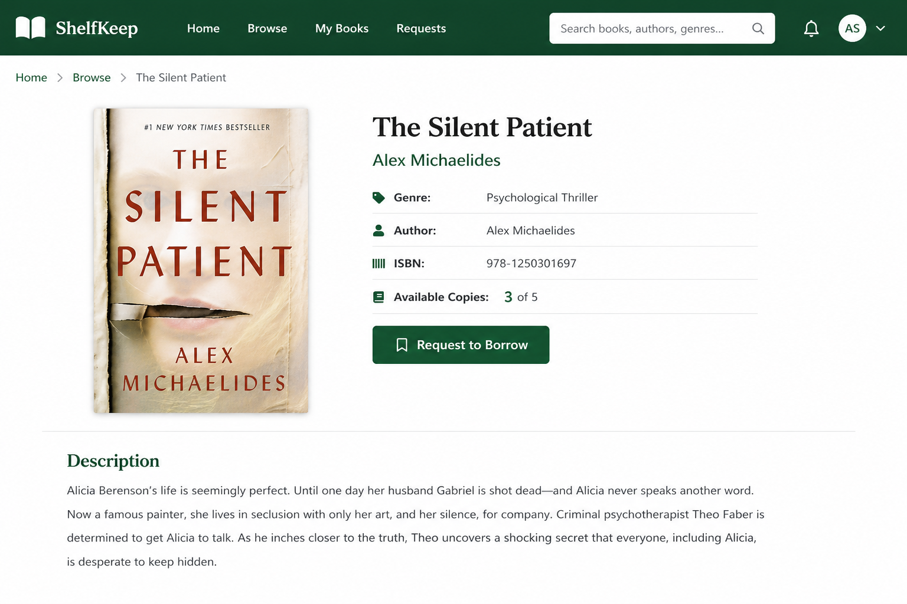
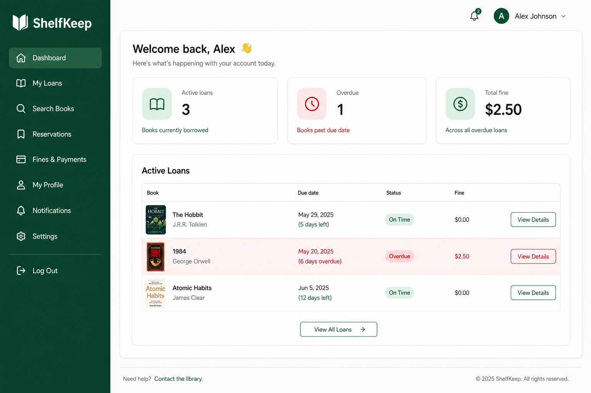
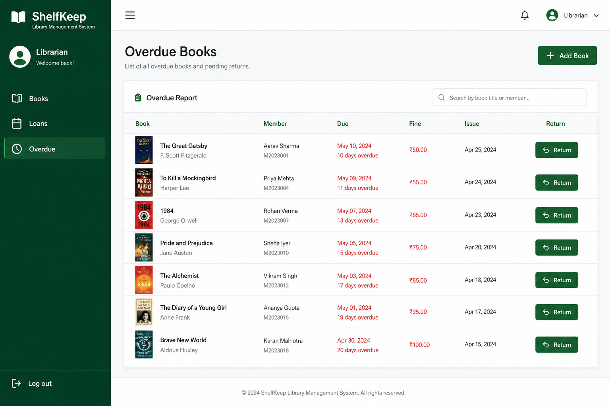
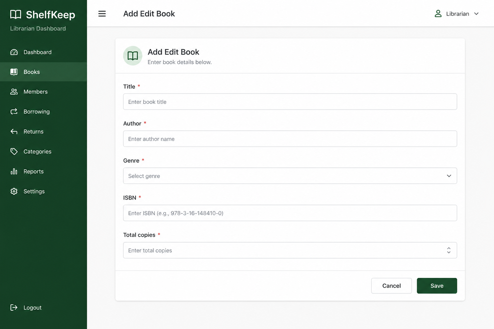
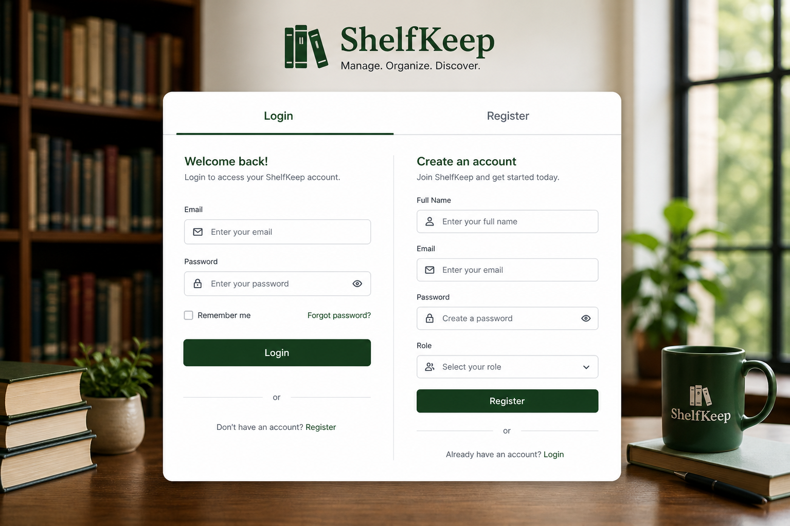

# Project instructions — Library Management (ShelfKeep)

Build a library system where members borrow books and librarians manage inventory, loans, and overdue fines. Boilerplate includes React Router, Bootstrap, Redux Toolkit (`welcomeSlice`), Express, and `/api/welcome`.

Also read [README.md](./README.md), [DATA_MODEL.md](./DATA_MODEL.md), [GRADING_CRITERIA.md](./GRADING_CRITERIA.md), and [docs/mockups/](./docs/mockups/).

---

## 1. Learning goals

| Area | Practice |
|------|----------|
| Redux Toolkit thunks | auth, books, loans |
| Conditional Mongo updates | safe copy decrement on borrow |
| Role-based UX | member vs librarian dashboards |
| Date/fine logic | due dates and overdue calculation |
| Mongoose populate | loan lists with book + member |

---

## 2. Product overview

**ShelfKeep** tracks books and loans.

| Role | Capabilities |
|------|----------------|
| Guest | Browse catalog + book detail (no borrow) |
| `member` | Request borrow; view own loans/fines |
| `librarian` | Member powers + book CRUD, issue/return for any member, overdue report |

Non-goals unless stretch: barcode scanning, multi-branch libraries, payment of fines online.

---

## 3. Tech stack

- Frontend: React 18, Vite, React Router, Bootstrap, **Redux Toolkit**
- Backend: Express ESM, Mongoose 8, bcryptjs, JWT
- DB: MongoDB Atlas `MONGO_URI` (backend port **5003**)
- Suggested env extras: `LOAN_DAYS=14`, `FINE_PER_DAY_CENTS=50`

---

## 4. Mockups

### Catalog

Search, genre filter, book cards with availability badge.

### Book detail

Metadata, available copies, Request borrow button.

### Member dashboard

Active loans, due dates, overdue highlight, fines.

### Librarian dashboard

Overdue report, issue/return actions, navigation to books.

### Add / edit book form

### Login / Register

---

## 5. Frontend architecture

### Routes

| Path | Access | Page |
|------|--------|------|
| `/` | public | Home welcome |
| `/catalog` | public | Book list |
| `/books/:id` | public | Book detail |
| `/login`, `/register` | guest | Auth |
| `/my/loans` | member/librarian | Member dashboard |
| `/librarian` | librarian | Overdue + ops hub |
| `/librarian/books` | librarian | Book table + link to form |
| `/librarian/books/new`, `/librarian/books/:id/edit` | librarian | Book form |
| `*` | public | NotFound |

### Redux slices

| Slice | Responsibility |
|-------|----------------|
| `auth` | login/register/logout, token hydration |
| `books` | catalog list/detail, librarian CRUD thunks |
| `loans` | my loans, borrow, librarian return/issue, overdue list |
| `welcome` | provided sample |

ProtectedRoute with optional `roles={['librarian']}`.

---

## 6. Backend API contract

Errors: `{ "error", "message" }` with 400/401/403/404/409/500.

### Auth

- `POST /api/auth/register` — always creates `member`
- `POST /api/auth/login`
- `GET /api/auth/me`
- Middleware `requireAuth`, `requireRole('librarian')`

### Books

| Method | Path | Auth | Notes |
|--------|------|------|-------|
| GET | `/api/books` | public | Query `q`, `genre`, `page`, `limit` |
| GET | `/api/books/:id` | public | Detail |
| POST | `/api/books` | librarian | Create; set `availableCopies = totalCopies` initially |
| PATCH | `/api/books/:id` | librarian | Update metadata; careful if changing `totalCopies` |
| DELETE | `/api/books/:id` | librarian | Only if no active loans (else 409) |

### Loans

| Method | Path | Auth | Notes |
|--------|------|------|-------|
| POST | `/api/loans` | member/librarian | Body `{ bookId }` (member borrows for self) or librarian `{ bookId, memberId }` |
| GET | `/api/loans/mine` | auth | Current user's loans |
| GET | `/api/loans/overdue` | librarian | Active past due |
| POST | `/api/loans/:id/return` | librarian (or owning member — pick one and document) | Compute fine, restore copy |

Borrow must use conditional `availableCopies` decrement (see `DATA_MODEL.md`).

---

## 7. User stories

### US-01 Browse

- [ ] Catalog search by title/author
- [ ] Genre filter
- [ ] Detail shows availability

### US-02 Borrow

- [ ] Logged-in member can borrow when copies available
- [ ] Availability decreases
- [ ] Loan appears on `/my/loans` with due date
- [ ] Borrowing when none available returns clear error

### US-03 Return + fines

- [ ] Librarian can mark returned
- [ ] Late return shows fine > 0
- [ ] `availableCopies` increments

### US-04 Librarian inventory

- [ ] Create/edit books
- [ ] Overdue dashboard lists late loans
- [ ] Members cannot access librarian routes (**403**/redirect)

---

## 8. Security checklist

- Hash passwords; JWT secret from env
- Never trust client to set `role: librarian` on register
- Validate ObjectIds
- CORS via `CLIENT_ORIGIN`
- No `.env` in git

---

## 9. Ordered milestones

1. Configure MongoURI; confirm welcome on Home  
2. Models: User, Book, Loan  
3. Auth + Redux auth slice  
4. Books API + catalog/detail pages  
5. Borrow flow + my loans  
6. Return + fine calculation  
7. Librarian book CRUD + overdue report  
8. Polish + self-grade  

---

## 10. Stretch

- Reservation queue, email reminders, per-copy barcodes, pay fines, CSV export of overdue

## 11. Submission checklist

- [ ] Seed librarian + sample books documented  
- [ ] `LOAN_DAYS` / fine policy documented in README  
- [ ] Frontend production build works  
- [ ] Demo script: member borrows → librarian returns late book → fine visible  

## 12. Definition of done

With only `.env` filled, a reviewer can borrow and return books, see availability stay consistent, and use the librarian overdue view.
